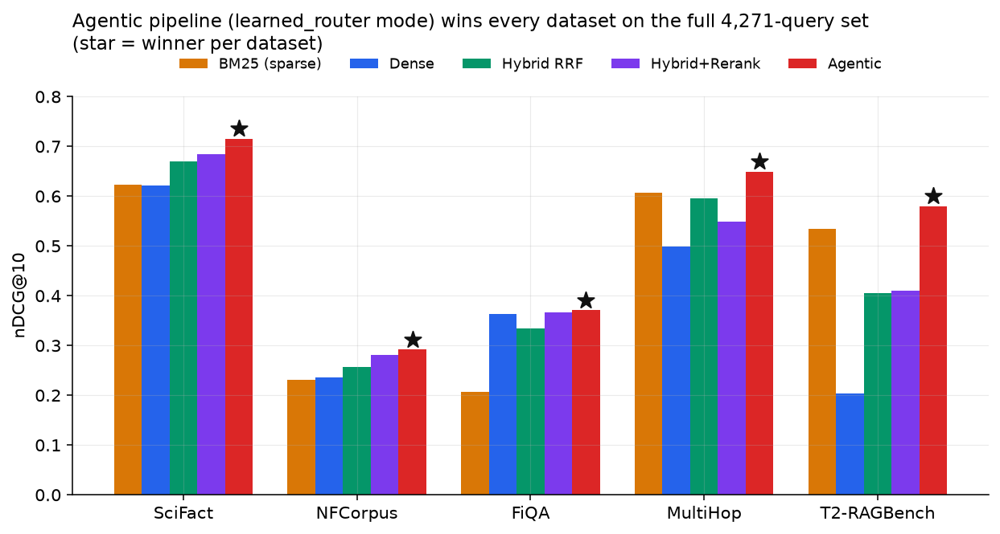
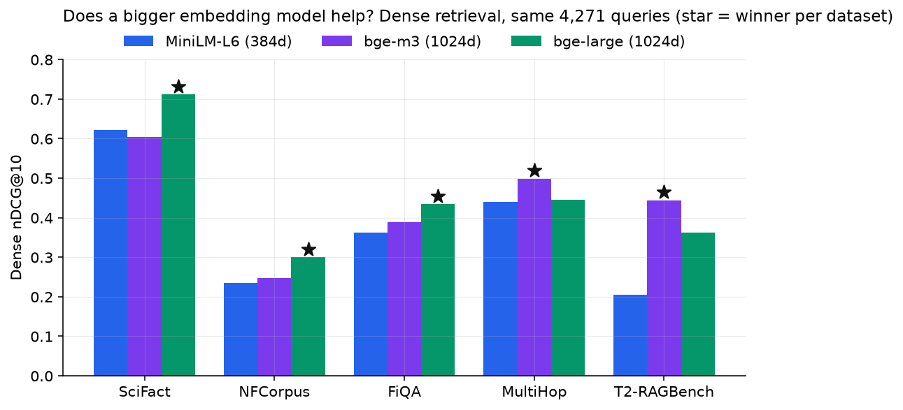
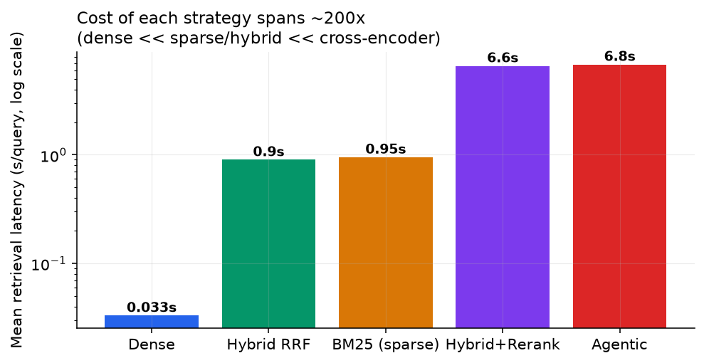

# Agentic RAG pipeline

[](https://github.com/theju3904/agentic-rag/actions/workflows/ci.yml)
[](https://www.python.org/)

**Jump to:** [Tech stack](#tech-stack) · [Results](#results) · [Quickstart](#quickstart)

## Contents

- [Results](#results)
- [Quickstart](#quickstart)
- [The pipelines](#the-pipelines)
- [Datasets](#datasets)
- [Further reading](#further-reading)
- [Tech stack](#tech-stack)

## Results



**The agentic pipeline wins every dataset** on the full 4,271-query evaluation. Mean nDCG@10 =
**0.521** vs the best classic baseline (Hybrid + Rerank) at **0.458** - a +0.063 lift, and the only
pipeline that is on top on *every* individual dataset, not just on the average.

Four classic retrieval pipelines (BM25, dense, hybrid, hybrid + cross-encoder reranker) plus one
agentic pipeline, benchmarked on the same 74,000-document corpus and 4,271 questions, same
generator, scored the same way. The agentic pipeline is a **family of three modes** - see
[The pipelines](#the-pipelines) below for the mode-by-mode breakdown, or
[report/RESULTS_TECHNICAL.md](report/RESULTS_TECHNICAL.md) for per-dataset numbers and run IDs.

---



**The embedding model is a high-leverage upgrade.** Re-running dense retrieval with three embedders
on the identical 4,271 queries lifted mean dense nDCG@10 from 0.373 (MiniLM) to 0.451 (bge-large) -
a ~20% relative gain from swapping one component. bge-m3 more than doubled the score on the
finance-table dataset (0.21 to 0.44), the hardest number-and-entity-heavy set.

---



**Expensive is not always better.** The cross-encoder pipelines are ~200x slower per query than
dense ANN search (seconds vs. milliseconds), and on identifier/number-heavy corpora (MultiHop news,
T2 finance tables) blanket reranking actually *hurts* ranking quality. The agentic pipeline's win
comes from applying rerank *selectively* based on query shape, not blanketing it on everything.

---

## Quickstart

Prerequisites: Python 3.11+, Docker, about 2 GB of disk for model downloads.

```powershell
# 1. Start Postgres + Qdrant
docker compose up -d postgres qdrant

# 2. Install and configure
python -m venv .venv
.\.venv\Scripts\pip install -e ".[dev]"
cp .env.example .env

# 3. Build the dataset, index it, and run the full evaluation.
#    `evaluate` prints the run-id of the completed run; copy it into steps 4+.
python -m agentic_rag.cli init-db          # create Postgres tables
python -m agentic_rag.cli build-dataset    # download + combine 5 public benchmarks
python -m agentic_rag.cli index            # chunk + embed + store
python -m agentic_rag.cli calibrate        # fit the agentic pipeline's thresholds
python -m agentic_rag.cli evaluate         # run all 5 pipelines, persist results; prints <run-id>
python -m agentic_rag.cli report <run-id>  # render report/results.md

# 4. Train the agentic pipeline's recommended `learned_router` mode.
#    This is what produces the headline nDCG@10 = 0.521 in the Results chart;
#    without it, the agentic pipeline falls back to `heuristic_router` and the
#    mean nDCG@10 is ~0.483 (still wins on some datasets, loses on others).
python -m agentic_rag.cli train-router <run-id> --delta 0.10

# 5. (optional) Serve the API + demo UI
python -m agentic_rag.cli serve            # demo at http://localhost:8000, API docs at /docs

# Steps 1-3 are mandatory. Step 4 enables the `learned_router` mode;
# without a trained artifact the agentic pipeline falls back to
# `heuristic_router` (zero-training) and keeps working unchanged.
# Switch modes at run time via AGENTIC_MODE={learned_router,heuristic_router,per_doc}.
```

Every number in the reports regenerates from these commands; nothing is hand-written. To compare
embedding models fairly, set `EMBEDDING_MODEL_NAME` / `QDRANT_COLLECTION_NAME` (and
`REMOTE_EMBEDDING_URL` for a GPU server) and run `evaluate --retrieval-only`.

## The pipelines

The agentic pipeline makes a **per-query runtime decision** about which retrieval path to take -
rather than running one fixed pipeline on every input. The decision function is swappable: a
hand-written heuristic, an LLM grader, or a trained classifier are all agentic in the same sense.
"Agentic" is about per-query adaptivity, not about which flavor of model drives the decision -
which is why XGBoost sits comfortably inside the agentic pipeline alongside the LangGraph
state-machine mode.

| | Pipeline | What it adds | Isolates |
|---|---|---|---|
| P1 | `sparse_bm25` | Lexical keyword matching | The baseline |
| P2 | `dense` | Semantic (bi-encoder) search | Value of embeddings |
| P3 | `hybrid_rrf` | Fuses P1 + P2 (Reciprocal Rank Fusion) | Value of combining signals |
| P4 | `hybrid_reranked` | Cross-encoder re-ranks the top candidates | Value of a second-stage reranker |
| P5 | `agentic_corrective` | Per-query runtime decision over retrieval (see modes below) | Value of per-query routing |

The agentic pipeline (P5) has three selectable modes, chosen at startup via the `AGENTIC_MODE`
setting. All three implement the same `Retriever` interface, so swapping modes needs no other code
change:

- **`learned_router`** *(default when a trained artifact exists)* - runs BM25, Dense, Hybrid+Rerank
  and the `heuristic_router` agentic branch for the current query, extracts 12 query-text features +
  4 retrieval-overlap features, and asks a trained XGBoost classifier which pool to return. Trained via
  `agentic-rag train-router <run-id>` on the per-query outcome of past runs with a tie-aware target
  (δ = 0.10). Falls back to `heuristic_router` if the artifact is missing.
- **`heuristic_router`** *(zero-training default)* - a small LangGraph router that classifies each
  query by text features (identifier/number density, length, question-word shape, ...) and routes to
  BM25 (no rerank) or Hybrid+Rerank accordingly. Also runs the per-document grader for the
  abstention path.
- **`per_doc`** - the classic CRAG shape: hybrid+rerank, then an LLM grader per retrieved document,
  with a single rewrite-and-retry on ambiguous pools and abstention on confidently-irrelevant ones.
  Implemented as a LangGraph state machine (nodes: `retrieve_and_rerank`, `grade_and_decide`,
  `rewrite`, `finalize`). This mode is what makes "agentic" visible as explicit control flow; the
  router modes compress the same decision into a cheaper decision function.

### Why one pipeline, three modes

Classic ML (XGBoost) and LangGraph state machines are both ways to build a per-query decision
function - they are not competing categories. `learned_router` trains that decision function from
data; `heuristic_router` writes it by hand; `per_doc` lets an LLM grader drive it one document at a
time. The three share the same retrieval primitives (BM25, Dense, Hybrid+Rerank) and the same
`agentic_corrective` strategy slot in the retrieval ledger; the only difference is the decision
function. `learned_router` wins the headline comparison because, on this corpus, a trained
classifier over 16 cheap features generalizes better than hand-written rules or per-document LLM
grading - but switching modes is one environment variable.

## Datasets

The golden corpus combines five public benchmarks (about 74,000 documents and 4,271 evaluated
questions after stratified subsampling of the two largest sources). All are downloaded from Hugging
Face at build time; nothing is bundled in the repo.

| Dataset | What it tests | Docs / Queries |
|---|---|---|
| [BEIR SciFact](https://huggingface.co/datasets/BeIR/scifact) | Scientific claim verification | 5.2k / 300 |
| [BEIR NFCorpus](https://huggingface.co/datasets/BeIR/nfcorpus) | Medical and nutrition retrieval | 3.6k / 323 |
| [BEIR FiQA-2018](https://huggingface.co/datasets/BeIR/fiqa) | Financial opinion question answering | 57.6k / 648 |
| [MultiHop-RAG](https://huggingface.co/datasets/yixuantt/MultiHopRAG) | Multi-hop news QA, including unanswerable questions | 609 / 2,556 |
| [T2-RAGBench](https://huggingface.co/datasets/G4KMU/t2-ragbench-splits) | Finance text-and-table numeric QA | 7.3k / 23,088 |

## Further reading

| Doc | For |
|---|---|
| [report/RESULTS_SUMMARY.md](report/RESULTS_SUMMARY.md) | Plain-language results with charts (start here) |
| [report/RESULTS_TECHNICAL.md](report/RESULTS_TECHNICAL.md) | Full tables, statistics, and the three controlled experiments |

## Tech stack

| | |
|---|---|
| **GenAI / RAG** | **Retrieval-Augmented Generation (RAG)** · **AI Agents / Agentic AI** · **Large Language Models (LLMs)** · **Semantic Search** · **Prompt Engineering** · **LLM-as-a-Judge Evaluation** |
| **AI / ML** | **Machine Learning** · **Natural Language Processing (NLP)** · **LangGraph** · **sentence-transformers** · **Hugging Face Transformers** · **PyTorch** · **OpenAI SDK** · **Ollama** · **XGBoost** |
| **Retrieval** | **BM25** · **Dense bi-encoder ANN** · **Reciprocal Rank Fusion (RRF)** · **Cross-encoder reranking** · **Corrective RAG (CRAG)** · **Heuristic query routing** · **Learned (XGBoost) query routing** |
| **Models** | gpt-4o-mini · Gemma 3n E4B · flan-t5-base · all-MiniLM-L6-v2 · BAAI/bge-m3 · BAAI/bge-large-en-v1.5 · cross-encoder/ms-marco-MiniLM-L-6-v2 |
| **Databases** | **Vector Database (Qdrant)** · **PostgreSQL 16** · **pgvector** |
| **Backend / APIs** | **Python 3.11+** · **FastAPI** · **REST API** · **Pydantic v2** · **SQLAlchemy 2.0** · **Docker** · **Docker Compose** · **Uvicorn** |
| **DevOps / CI** | **CI/CD** · **GitHub Actions** · **Git** |
| **Evaluation** | **nDCG@10** · **Recall@10** · **MRR@10** · **MAP@10** · **LLM-as-judge** · **Paired-bootstrap significance testing** · **Bonferroni correction** · **Abstention accuracy** |
| **Code quality** | **pytest** · **mypy (static type checking)** · **Ruff** |
