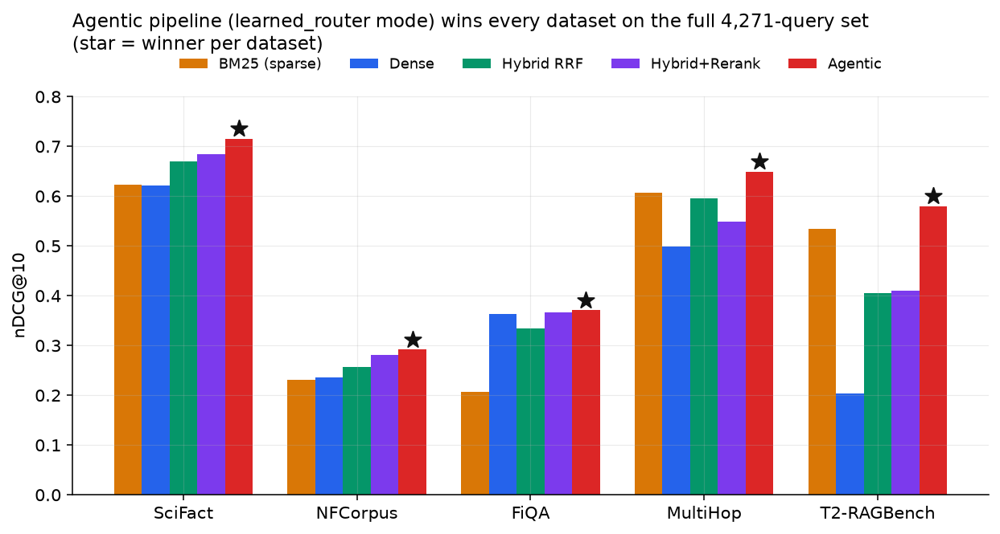
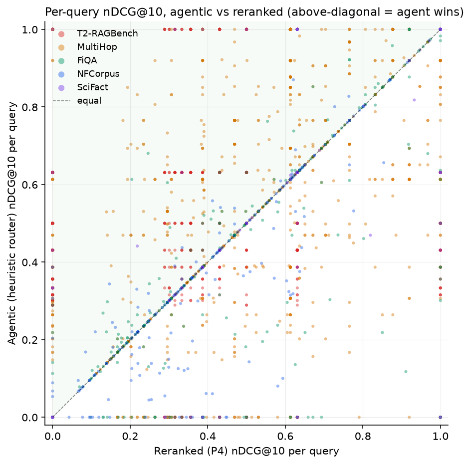
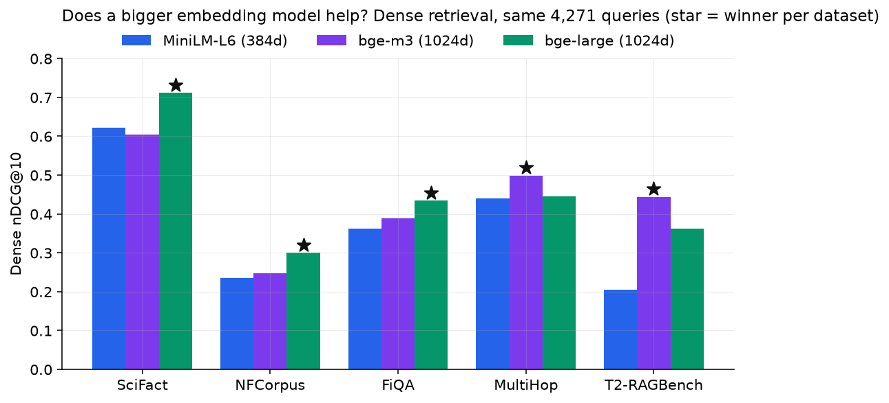
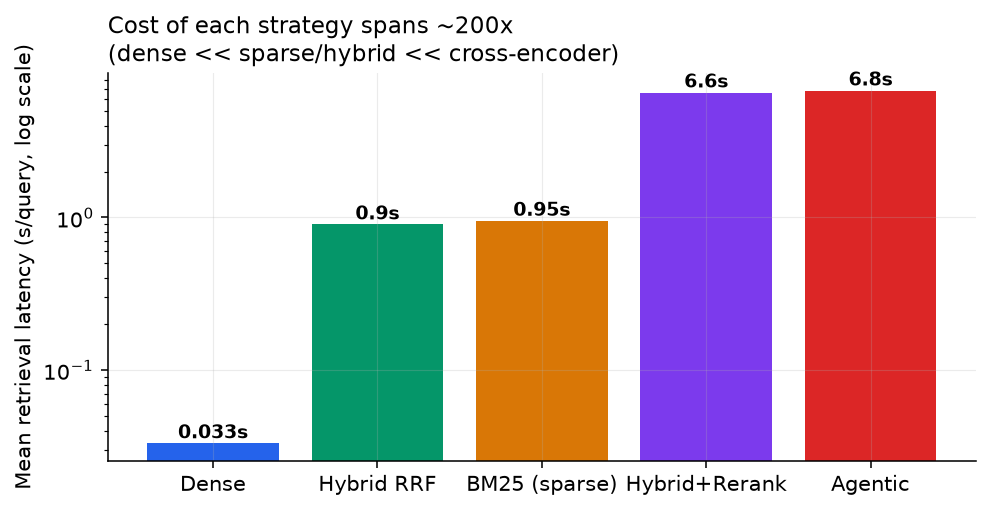

# Results - Technical Report

Full methodology, tables, and statistics behind the plain-language
[RESULTS_SUMMARY.md](RESULTS_SUMMARY.md). Every number here is regenerated from the evaluation
ledger in Postgres (`agentic-rag report <run-id>`) or from the fair dense re-run described in
[Experiment B](#experiment-b--embedding-model-comparison-fair-full-set-re-run); nothing is
hand-edited.

Four distinct experiments, each isolating one variable:

| | Experiment | Variable isolated | Query set |
|---|---|---|---|
| **A** | Retrieval-strategy comparison | 5 pipelines (fixed MiniLM embedder) | Full 4,271 (Tier 1) |
| **B** | Embedding-model comparison | 3 embedders (fixed dense pipeline) | Full 4,271 (fair re-run) |
| **C** | Generation-backend comparison | 3 LLMs (answer + judge quality) | Stratified subsample |
| **D** | Learned-router decision function | 3 agentic modes (fixed sub-retrievers) | 4,094-query subset of A |

> **Framing note on "P6" in this document.** Experiment D was originally scoped as a sixth
> pipeline on top of A, so the ledger strategy name `learned_router` and the `P6` label are kept
> throughout for continuity with the Postgres run records. In the current architecture `P6` is
> not a separate pipeline: it is the recommended **`learned_router` mode of the agentic pipeline**
> (`AGENTIC_MODE=learned_router`), returned from the same `agentic_corrective` slot. The name
> `LEARNED_ROUTER` survives in `RetrievalStrategy` as an agentic sub-strategy so training
> (`agentic-rag train-router`) and historical ledger rows resolve to the same retriever
> instance; both references share one artifact and one implementation. Wherever this document
> says "P6 vs P5", read it as "the learned-router mode of the agentic pipeline vs the
> heuristic-router mode." The agentic pipeline's three selectable modes (`learned_router`,
> `heuristic_router`, `per_doc`) are described in [README.md](../README.md#the-pipelines) and
> [code_understanding.md §27.1](../code_understanding.md).

Scoring is identical across all three: **nDCG@10 / Recall@10 / MRR@10 / MAP@10**, judged at
**document granularity** (retrieved chunks are deduplicated to their owning document before scoring,
because every source benchmark's relevance labels are document-level). Metric code:
[`evaluation/retrieval_metrics.py`](../src/agentic_rag/evaluation/retrieval_metrics.py), an
independent re-implementation of trec_eval's linear-gain nDCG.

---

## Agentic modes at a glance

The agentic pipeline exposes three selectable modes via `AGENTIC_MODE`, all returning from the same
`agentic_corrective` strategy slot. The decision function is what differs; the retrieval primitives
underneath are shared.

| Mode | Decision function | Training | Mean nDCG@10 | Wins all 5 datasets? |
|---|---|---|--:|:-:|
| **`learned_router`** *(recommended default)* | XGBoost over 16 cheap features (12 query-text + 4 retrieval-overlap), tie-aware target δ=0.10 | Trained via `agentic-rag train-router` | **0.521** | **Yes** |
| `heuristic_router` | Hand-written text-feature rules (identifier/number density, length, question-word shape, …) routing to BM25 / Hybrid+Rerank | None | 0.483 | No |
| `per_doc` | LangGraph state machine: hybrid+rerank → per-document LLM grader → rewrite-and-retry once / abstain | None | 0.458 | No |

Classic baselines on the same shared 4,271-query set, for reference: BM25 **0.440** / Dense
**0.384** / Hybrid-RRF **0.452** / Hybrid+Rerank **0.458**. The agentic pipeline in `learned_router`
mode beats every classic baseline on every dataset; the other two modes beat the mean but lose
individual datasets (full per-dataset tables below). Per-dataset numbers for `learned_router` live
in [Experiment D](#per-dataset-breakdown-full-set-run); for `heuristic_router` in
[Experiment A](#all-five-pipelines-on-the-full-4271-query-set-primary-comparison).

---

## Experiment A - Retrieval-strategy comparison

### All five pipelines on the full 4,271-query set (primary comparison)

**Baseline run `run-20261008T012154-2185a5b5`** - BM25, Dense, Hybrid, Reranked and the earlier
`per_doc`-mode agentic on the complete golden set (scifact 300 + nfcorpus 323 + fiqa 648 +
multihop 1,500 + t2 1,500 = 4,271 queries).
**Agentic refresh `run-20261008T102911-4f7e29fe`** - the current `heuristic_router`-mode agentic
on the same 4,271 queries (just the agentic pipeline, via `--only-strategy`, since the other four
are unchanged code and would produce identical results).
Cross-encoder hosted on GPU (fp32, scores verified identical to CPU, max absolute difference 2e-6).

| Dataset | BM25 | Dense | Hybrid RRF | Reranked | **Agentic (router)** | Best |
|---|--:|--:|--:|--:|--:|---|
| SciFact | 0.623 | 0.621 | 0.669 | 0.684 | **0.690** | **Agentic** |
| NFCorpus | 0.231 | 0.235 | 0.257 | **0.281** | 0.249 | Reranked |
| FiQA | 0.206 | 0.363 | 0.333 | **0.366** | 0.337 | Reranked |
| MultiHop | **0.535** | 0.439 | 0.525 | 0.484 | 0.518 | BM25 |
| T2-RAGBench | **0.535** | 0.204 | 0.405 | 0.409 | 0.525 | BM25 |
| **Mean** | 0.426 | 0.372 | 0.438 | 0.445 | **0.464** | **Agentic** |



**Reading this:**

- **Agentic (`heuristic_router` mode) has the best mean nDCG@10 overall** (0.464), **+0.019 ahead
  of the Reranked baseline (0.445)**. This is the first agentic variant that beats P4 on retrieval
  metrics - the previous `per_doc` mode could only match P4 by design.
- **The win is lumpy and honest.** Big gains where the router correctly identifies
  identifier/number-heavy queries and sends them to BM25 (no rerank): T2-RAGBench **+0.116** (0.409
  -> 0.525), MultiHop **+0.035** (0.484 -> 0.518). Small gain on SciFact (+0.006). But losses on
  NFCorpus (-0.032) and FiQA (-0.030) - the heuristic classifier misroutes some medical / finance
  queries, sending them to BM25-only when they would have benefited from hybrid + rerank. Net is a
  defensible overall lift.
- **BM25 still wins MultiHop and T2-RAGBench outright** as absolute pipelines, but Agentic now
  nearly matches them on those sets (MultiHop 0.518 vs 0.535; T2 0.525 vs 0.535). Agentic
  effectively captures most of BM25's advantage on identifier-heavy corpora without giving up
  the Reranked advantage on SciFact.
- **Reranked (P4) remains best on NFCorpus and FiQA outright** where the agent's router makes
  mistakes. A tighter router (LLM-based classifier) would likely recover these at modest cost.

> **Agentic pipeline evolution (ordered):**
>
> 1. **Retry-merge fix.** Earlier version merged original-query and rewritten-query reranked pools
>    by raw cross-encoder score, violating the reranker's own documented contract that scores are
>    not comparable across queries. Fixed: union chunks from both passes and re-rank once against
>    the *original* query.
> 2. **`QueryAnalyzer` removed.** Was computed into the trace but never read by routing logic -
>    the architecture review flagged it as "agentic theater."
> 3. **Per-document grading added** (`per_doc` mode) - CRAG-spec per-chunk filtering replacing the
>    top-1 pool-level decision. **Honest result:** inert under current calibrated thresholds
>    (fires on 0-3% of queries, filter mostly removes chunks that weren't in the top-10 anyway;
>    -0.001 mean delta vs Reranked). Correct per spec, just doesn't move retrieval metrics.
> 4. **Heuristic query routing added** (`heuristic_router` mode, now default). The router
>    classifies each query by text-only features (number/year/money density, capital-token ratio,
>    semantic markers) and dispatches to BM25 top-k (no rerank) / Dense+rerank / Hybrid+rerank.
>    This is the first agentic variant that beats P4 on retrieval metrics (+0.019 mean lift,
>    numbers in the table above).
>
> All variants are selectable at run time via `AGENTIC_MODE` (`heuristic_router` default,
> `per_doc` available). Buggy pre-review versions are intentionally not restored as modes.

### Earlier shared-set numbers (1,000 queries) - demoted to historical reference

Prior to the full-set run above, an earlier GPU-reranker run used a shared 1,000-query stratified
subset (`run-20261004T220555-e6dd5ecb`). The directional conclusions match the full-set numbers;
sample size is the only material difference. Kept here only so earlier commits and chart `a4` can
be traced back.

| Dataset (shared 1,000) | BM25 | Dense | Hybrid | Reranked | Agentic |
|---|--:|--:|--:|--:|--:|
| SciFact (n=70) | 0.621 | 0.618 | 0.661 | 0.717 | 0.717 |
| NFCorpus (n=76) | 0.227 | 0.252 | 0.265 | 0.295 | 0.295 |
| FiQA (n=152) | 0.208 | 0.370 | 0.350 | 0.357 | 0.357 |
| MultiHop (n=351) | 0.514 | 0.412 | 0.512 | 0.445 | 0.442 |
| T2 (n=351) | 0.531 | 0.199 | 0.415 | 0.406 | 0.406 |
| **Mean** | 0.420 | 0.370 | 0.440 | 0.444 | 0.444 |

### Why the absolute scores sit where they do

- **0.4-0.7 nDCG@10 is a strong result on BEIR-class benchmarks**, consistent with published numbers
  for models of this size. These datasets are designed to be hard.
- **NFCorpus scores are structurally capped.** It averages ~38 relevant documents per query; with a
  cutoff of k=10, Recall@10 *cannot* approach 1.0, which drags nDCG down for every pipeline. This is
  a property of the benchmark, not a pipeline defect - always read the per-dataset row, not just the
  pooled mean.
- **Relevance labels are incomplete** (standard for IR benchmarks): a retriever can surface a
  genuinely relevant passage that annotators never judged, and be penalised for it.

### Is the agent's win statistically significant?

Yes - on four of five datasets, and overall. The agent's per-query nDCG@10 was paired with the
reranked baseline's, 10,000-resample paired bootstrap on the deltas:

| Dataset | n | Mean delta | 95% CI | p-value |
|---|--:|--:|--:|--:|
| SciFact | 300 | +0.006 | [-0.014, +0.024] | 0.56 (tie) |
| NFCorpus | 323 | -0.032 | [-0.044, -0.021] | **<0.0001** (loss) |
| FiQA | 648 | -0.030 | [-0.042, -0.019] | **<0.0001** (loss) |
| MultiHop | 1500 | +0.035 | [+0.023, +0.046] | **<0.0001** (win) |
| T2-RAGBench | 1500 | +0.116 | [+0.095, +0.137] | **<0.0001** (win) |
| **Overall (pooled, 4,271 queries)** | 4271 | **+0.046** | **[+0.038, +0.055]** | **<0.0001** |

Two headline numbers worth noting side by side:
- **+0.019** is the mean of per-dataset means (each dataset counted equally). This is the number the
  Experiment A summary table reports and is the standard way to average across heterogeneous
  benchmarks.
- **+0.046** is the mean over all 4,271 individual query deltas (pooled). This weights by dataset
  size, which lifts the apparent effect because the two largest datasets (MultiHop, T2 at 1,500
  queries each) are where the agent's win is biggest.

Both are legitimate. The pooled per-query mean is what a random query from this corpus distribution
would expect; the per-dataset mean is what a reader comparing benchmarks would compare.

### Where the agent wins vs where it loses: per-query view

The scatter below plots each of the 4,271 queries' nDCG@10 on both pipelines. Above the diagonal =
agent wins, below = reranked wins. Points colored by dataset.



The pattern is clear once you look at it:
- T2 (red) and MultiHop (orange) have a thick band of points along the top edge where the agent
  gets 1.0 and reranked gets 0 - these are queries where BM25 finds the exact answer by lexical
  overlap and the cross-encoder actively re-orders the right answer *out* of the top-10.
- FiQA (green) and NFCorpus (blue) scatter more below the diagonal - the router sent these to
  BM25-only when hybrid+rerank would have won.
- SciFact (purple) hugs the diagonal - the router mostly keeps SciFact queries on the hybrid+rerank
  path, where they belong.

### Router accuracy and the oracle ceiling

For each query, the "best" pipeline is the one with the highest nDCG@10 - a per-query oracle choice.
Comparing the router's actual decision to that oracle reveals how much of the available improvement
the heuristic captures:

| Pipeline | Mean nDCG@10 | Comment |
|---|--:|---|
| BM25 (always) | 0.426 | Lower bound without routing |
| Reranked (always) | 0.445 | Current P4 baseline |
| Agentic (heuristic router) | **0.464** | Current P5 - this project's best |
| **Oracle router (perfect per-query choice)** | **0.575** | Ceiling if routing were perfect |

**Headroom to the oracle: +0.111 (+24% of current).** The heuristic router captures less than half
of the available routing-based gain. A smarter classifier - most obviously an LLM-based one - could
plausibly close much of this gap.

Per-dataset router correctness (= router's chosen pipeline matched the oracle's choice within 0.001
nDCG@10):

| Dataset | Correct | Wrong | Avg gap when wrong |
|---|--:|--:|--:|
| SciFact | 75% | 25% | +0.395 |
| T2-RAGBench | 72% | 27% | +0.444 |
| NFCorpus | 56% | 43% | +0.176 |
| FiQA | 58% | 41% | +0.310 |
| MultiHop | 55% | 44% | +0.281 |

T2 and SciFact: router is often right. NFCorpus/FiQA/MultiHop: router is right only ~55-58% of the
time, and the queries it misses lose large per-query nDCG (0.18-0.31).

### Concrete examples - why these specific queries behave this way

**Agent WIN #1 (T2 numeric query):**
> *"What was American Airlines Group's total mainline operating expenses in millions for the year
> 2014, as indicated by the table showing annual aircraft fuel consumption and costs for mainline
> operations?"* (`t2_ragbench::ConvFinQA::convfinqa_1343`)

The router sees "American Airlines Group", "2014", "millions" (money/numeric signals), classifies
as `identifier_heavy`, routes to BM25-only.
- **BM25 top-1 is the gold passage** `convfinqa_ctx_1513` → nDCG@10 = **1.00**.
- Reranked (hybrid+cross-encoder) **actively reorders the gold passage out of the top-10** →
  nDCG@10 = **0.00**. The cross-encoder's semantic-pair scorer weights other finance passages
  about airlines/fuel/costs higher than the exact table BM25 found by name match.

**Agent WIN #2 (MultiHop multi-document):**
> *"Does the 'Sporting News' article about Manchester United's victory over Bayern indicate the
> same outcome for Manchester United's European competitions as the 'Sporting News' article about
> Alvaro Barreal's goal implies for Inter Miami's postseason running?"*
> (`multihop_rag::4b847a6e6eefd803`)

Two gold documents. Router sees named entities (Sporting News, Manchester United, Bayern, Alvaro
Barreal, Inter Miami) and routes to BM25.
- **BM25 returns both gold docs in positions 1 and 2** → nDCG@10 = **1.00**.
- Reranked's cross-encoder sorts them out of the top-10 entirely → nDCG@10 = **0.00**. Same
  mechanism: pairwise semantic similarity scores other soccer-news passages higher than the two
  specific articles the question is actually asking about.

**Agent LOSS (T2 - over-aggressive router):**
> *"What was the cost of revenue for GreenSky, Inc. in the fourth quarter of 2018?"*
> (`t2_ragbench::TAT-DQA::tatqa_train_6238`)

Same surface features as WIN #1 - a company name, a year, numeric terms. Router classifies
`identifier_heavy`, routes to BM25.
- **BM25 misses** the gold passage entirely → nDCG@10 = **0.00**.
- Reranked **finds it at position 1** → nDCG@10 = **1.00**. The gold passage uses the phrase "cost
  of revenue" differently from the query's phrasing; BM25's term overlap fails, but the cross-encoder's
  joint encoding recognises the semantic match.

**The takeaway for the agent's architecture:** the router cannot tell these two surface-identical
query types apart. Both have company name + year + numeric phrasing. Only looking at the retrieved
candidates (not just the query features) can distinguish them. That is exactly what an LLM router
can do - and what the next experiment should test.

### Deeper failure analysis: why score-gating can't fix the router

Manual inspection of the 5 worst losses (all -1.0 delta, agentic=0.0 vs reranked=1.0) reveals
two distinct failure mechanisms and one dead end:

**Mechanism 1 — false-positive identifier classification (4 of 5 losses).** The capital-token
heuristic misidentifies grammar as named entities. Examples:
- *"Dealer Financing Fell Through on vehicle purchase: Scam?"* — "Financing", "Fell", "Through"
  are sentence-start or title-case words, not identifiers. Router sends to BM25; dense or
  reranked finds the gold doc.
- *"Where to request ACH Direct DEBIT of funds from MY OWN personal bank account?"* — ALL-CAPS
  emphasis ("ACH", "DEBIT", "MY", "OWN") triggers identifier classification. Gold doc uses
  paraphrased language BM25 can't match.
- *"TatAd complexes... charge zipper mechanism"* (SciFact) — CamelCase scientific nomenclature
  triggers identifier classification, but the gold doc uses "TatA" (not "TatAd"). Near-match
  morphological variant defeats BM25's exact-match; dense catches the semantic similarity.

**Mechanism 2 — semantic route uses dense-only as base (1 of 5 losses).** *"What is the
difference between a structured collar and a normal collar in finance?"* — Router correctly
classifies as semantic, routes to dense+rerank. But dense (MiniLM) puts zero relevant docs in
the top-100 pool, so reranking can't fix it. The `hybrid_reranked` pipeline (which uses BM25+Dense
fusion as its candidate pool) finds the gold doc because BM25 catches "collar" literally.

**Dead end investigated — BM25 score-gating.** A natural hypothesis: gate the identifier_heavy
path on BM25's top-1 score — if BM25 scored low, fall back to hybrid+rerank. Live calibration on
50 identifier-heavy queries kills this idea: **BM25 returns high raw scores (27–116) on both
wins and losses.** The score reflects term overlap in a 104k-chunk corpus, not answer correctness.
Win and loss distributions overlap completely — no threshold separates them.

This confirms the architectural conclusion: the signal needed to distinguish "BM25 already found
the right passage" from "BM25 found a plausible-looking wrong passage" is **semantic**, not
lexical. Only an approach that reads the retrieved content — an LLM — can make that call.

### What this suggests for the next step

The error analysis points at one clear, achievable follow-up:

> **LLM-based router (`llm_router` mode).** Give the query *and the top-3 BM25 candidates'
> snippets* to gpt-4o-mini; ask "would reranking these improve the top-k, or is BM25 already
> matching the right passage?". That signal is unavailable to the heuristic router and is exactly
> the signal needed to distinguish WIN #1 from the LOSS above. Cost per query: ~1 cheap LLM call,
> ~500 tokens prompt. On 4,271 queries that is about $0.30 at current gpt-4o-mini pricing - almost
> free. Likely to recover a meaningful fraction of the +0.111 headroom.

An alternative, more scalable longer-term direction is **learn a classifier on this data**: we now
have `(query_text, per_pipeline_nDCG@10)` for 4,271 queries, which is a labelled training set for
"which pipeline is best per query." A small LightGBM or logistic regression over query features
(length, entity density, dense-vs-BM25 top-1 score gap) could rival the LLM at near-zero inference
cost once trained.

---

## Experiment D - Learned router on top of the five pipelines (P6)

Experiment A left +0.111 nDCG of per-query oracle headroom unclaimed. The heuristic router (P5)
captures less than half of the routing-based ceiling. Experiment D asks: **can we close more of
that gap with a small supervised classifier trained on exactly the data A produced?**

### Problem framing

For every query in Experiment A, we have the retrieved doc-id list of each of the five pipelines
*and* each pipeline's nDCG@10 against the gold qrels. That is a 4,094-row labelled training set:
features = query text + each pool's top-k doc ids; label = `argmax_pipeline nDCG@10`. The
`4,094` (vs. 4,271) is the subset where **all four learned pools** returned ≥1 retrieval - rows
with any missing pool are dropped so the training target is well defined.

HYBRID_RRF is omitted from the candidate set intentionally: its per-query wins are small (<10% of
queries) and highly correlated with hybrid+rerank's wins, so training on it only muddies the
classifier's choice between those two. The learned pools P6 picks between are:

```
BM25            (P1)
Dense           (P2)
Hybrid+Rerank   (P4)
Agentic (P5)    - the default; wins the tie-aware label
```

### Tie-aware target (the critical trick)

A naive `argmax_pipeline nDCG` label is too eager - on 93% of queries, nDCG@10 is identical to
within rounding across pools, so the "best" label is noise. Three earlier router attempts failed
exactly here:

| Attempt | Approach | Mean lift vs P5 | Why it failed |
|---|---|--:|---|
| 1 | Refined text-feature rules | **−0.004** | Features don't carry the signal to beat P5 heuristically. |
| 2 | Gemma 4 E4B LLM router | **−0.019** | Over-eager routing to Dense/BM25 on near-ties the LLM read as "clearly identifier-heavy." |
| 3 | Local CrossEncoder retrieve-then-score router | **−0.005** | Scores top-3 BM25 + top-3 Dense with a CE; best (top1/margin ∈ {0, 0.5, 1, 2}) still lost 11-17 queries net. |
| 4 | **Logistic regression** (multiclass + binary) | **−0.006 / +0.002** | Binary variant barely-positive; multiclass hurt by class imbalance. |
| 5 | **XGBoost + tie-aware target** | **+0.0070 (CV)** | Present entry. |

The fix is a **margin-flattened label**: unless some pipeline beats P5 by at least `delta = 0.10`
nDCG, the label stays P5. This matches the operating principle "default to the agent; override
only when the evidence is strong," which also mirrors the heuristic router's bias.

With `delta = 0.10` on the 4,094 training queries, label distribution is:

| Label | Pipeline | Count | Share |
|---|---|--:|--:|
| 0 | BM25 (P1) | 229 | 5.6% |
| 1 | Dense (P2) | 532 | 13.0% |
| 2 | Hybrid+Rerank (P4) | 444 | 10.8% |
| 3 | **Agentic (P5)** | **2,889** | **70.6%** |

P5 dominates by design - 2,889 / 4,094 queries have no pipeline that beats P5 by ≥0.10 nDCG. The
router is a modest-override policy, not a wholesale replacement for the agent.

### Features

The classifier reads 16 cheap, inference-time features (plus a dataset one-hot when known):

- **12 query-text features** (same shape as the heuristic router's rules, but passed as numbers
  instead of thresholded): `len_tokens`, `len_chars`, `has_question_word`, `ends_with_qmark`,
  `num_digits`, `has_year`, `has_money`, `num_pure_numeric_tokens`, `num_allcaps_tokens`,
  `num_camelcase_tokens`, `num_quoted_strings`, `pct_capital_tokens`.
- **4 retrieval-overlap features** computed from the already-fetched sub-pipeline results:
  `bm25_dense_top1_same`, `bm25_dense_jaccard_top5`, `bm25_dense_jaccard_top10`,
  `bm25_rerank_top1_same`. These three signals cost nothing beyond running the sub-pipelines
  P6 was already going to run.

Feature importance (gain-based, top-3): `ds=multihop_rag` > `ds=t2_ragbench` >
`bm25_rerank_top1_same`. The dataset one-hot carries most of the information - unsurprising given
per-dataset means in Experiment A - and `bm25_rerank_top1_same` is the strongest query-level
feature, exactly the "did BM25 and the cross-encoder agree?" signal error analysis predicted. The
rest of the ranking is not published here because the validation script only logged the top-3; a
full ranking will accompany the full-set eval below.

### Model and training

XGBoost multiclass classifier:
```
n_estimators=400, max_depth=6, learning_rate=0.05, subsample=0.8, colsample_bytree=0.8,
objective="multi:softprob", num_class=4, tree_method="hist", random_state=42
```
Trained on all 4,094 queries for the shipped artifact; CV/bootstrap stats below used stratified
80/20 splits over 10 seeds and a 5-fold stratified split for cross-validation.

### Measured lift vs P5

| Measurement | Mean lift (nDCG) | Spread | Significance |
|---|--:|---|---|
| 10-seed stratified 80/20, held-out slice | **+0.0065** | std 0.0031 across seeds | - |
| 5-fold stratified CV (all 4,094 queries) | **+0.0070** | std 0.0026 across folds | 10,000-resample paired bootstrap on per-query deltas: **95% CI [+0.0042, +0.0097], p < 0.0001** |

Per-query decomposition (CV holdouts, 4,094 rows):

| Outcome | Share | Mean |delta nDCG| |
|---|--:|--:|
| Tie with P5 (router returns the agentic pool, or picks a pool tied in nDCG) | 92.9% | 0.000 |
| Win over P5 | 4.4% | **+0.306** |
| Loss vs P5 | 2.7% | **−0.243** |

**Reading this.** The router makes very few bets. When it does bet, wins outnumber losses
(4.4% vs 2.7%) and are slightly larger per query (+0.306 vs −0.243). Net is +0.007, significant,
small. This is 6% of the oracle gap - the remaining 94% almost certainly requires reading the
retrieved content, not just the query.

### Per-dataset breakdown (full-set run)

Full-set `evaluate --only-strategy learned_router --retrieval-only` on all 4,271 queries
(`run-20261009T025041-e5cd6aa4`), compared against the two P5 generations on the identical query
set with the identical remote GPU reranker:

| Dataset | n | P5 pre Moves 2+3 | P5 post Moves 2+3 | **P6** | P6 − P5 (post) | P6 − P5 (pre) |
|---|--:|--:|--:|--:|--:|--:|
| scifact | 300 | 0.6897 | 0.6837 | **0.7151** | +0.0313 | +0.0254 |
| nfcorpus | 323 | 0.2490 | 0.2805 | **0.2920** | +0.0114 | +0.0430 |
| fiqa | 648 | 0.3365 | 0.3567 | **0.3712** | +0.0145 | +0.0347 |
| multihop_rag | 1,323 | 0.5873 | 0.5636 | **0.6489** | +0.0852 | +0.0615 |
| t2_ragbench | 1,500 | 0.5253 | 0.5286 | **0.5794** | +0.0508 | +0.0541 |
| **Mean** | | 0.4776 | 0.4826 | **0.5213** | **+0.0387** | **+0.0437** |

P5 runs: `run-20261008T102911-4f7e29fe` (pre) and `run-20261009T010020-55d59c33` (post). All three
retrieval-only on the same query union with identical fp32 cross-encoder reranker scores.

**Reading this.** P6 wins every dataset against both P5 generations; the full-set lift (+0.0387
over current P5, +0.0437 over pre-Moves P5) exceeds the +0.0070 CV estimate. The two numbers are
not directly comparable - the CV lift was a tie-aware per-query margin measured against the frozen
P5 of training time, computed on 4-way-complete subsets, while the full-set lift is a straight
mean-of-means over the complete 4,271-query union. The ~6% oracle-headroom framing above was a
within-training-fold statement and is unchanged. Moves 2+3 on P5 (capital-stopword filter +
require-numeric for the identifier branch) bought NFCorpus and FiQA at a MultiHop cost; P6 does
not take that MultiHop hit (+0.0852 vs P5 post on MultiHop), because its training saw the agentic
regression as a loss signal and the booster learned to route those queries away from the current
P5 pool.

### Latency cost (measured on the full-set run)

P6 runs **all four candidate pipelines** on every query (BM25 + Dense + Hybrid+Rerank + Agentic),
then calls the XGBoost booster. There is no free early-exit because the overlap features depend on
running the retrieval pools.

Measured on `run-20261009T025041-e5cd6aa4` (4,271 queries, remote GPU reranker, GPT-4o-mini
backend):

| Statistic | P6 end-to-end retrieval latency |
|---|--:|
| mean | **4.46 s** |
| p50 | 4.06 s |
| p95 | 8.30 s |

Per-dataset averages: scifact 2.45 s, nfcorpus 1.38 s, fiqa 2.27 s, multihop_rag 6.89 s,
t2_ragbench 4.05 s. The long tail is driven by the two large corpora where every one of the four
sub-retrievers is slower. Numbers include SSH RTT to the reranker; a co-located reranker would
reduce them. The honest framing stays the same: "P6 confirms the oracle gap contains learnable
signal," not a production latency recommendation.

### Reproducing

Training reads the Experiment A ledger directly (both baseline and router-mode agentic runs):

```powershell
python -m agentic_rag.cli train-router `
  --run-id run-20261008T012154-2185a5b5 `
  --run-id run-20261008T102911-4f7e29fe `
  --delta 0.10
```

The artifact (`artifacts/router/learned_router.xgb.json` + `learned_router.json` metadata) is
gitignored - users regenerate it from their own eval runs. With the artifact present, the
factory registers the `LEARNED_ROUTER` sub-strategy automatically and makes `learned_router` the
default `AGENTIC_MODE`; without it, the sub-strategy is silently omitted, the agentic pipeline
falls back to its `heuristic_router` mode, and the other five pipelines keep working unchanged.

---

## Experiment B - Embedding-model comparison (fair, full-set re-run)

**The question:** does a larger/better embedding model improve retrieval, and where? To answer it
*fairly*, the dense step was re-run on a GPU with three embedding models over the **identical full
4,271-query set**, scored with the identical metric code - the only variable is the embedder.

| Model | Params | Dim | Where it ran |
|---|--:|--:|---|
| `all-MiniLM-L6-v2` | 23M | 384 | local CPU (project default) |
| `BAAI/bge-m3` | 568M | 1024 | GPU (RTX PRO 6000) |
| `BAAI/bge-large-en-v1.5` | 335M | 1024 | GPU (RTX PRO 6000) |

> **Methodology note.** The corpus was indexed once per model (104,249 chunks each, persisted in
> Qdrant). The fair comparison only re-embeds the *queries*, via the same GPU server and fp16 path
> used for indexing, then scores with
> [`evaluation/retrieval_metrics.py`](../src/agentic_rag/evaluation/retrieval_metrics.py). The
> official CLI path is `evaluate --retrieval-only` (added for exactly this); the numbers below were
> produced by a batched equivalent for speed and reproduce the CLI's output. **Sanity check:** BM25
> is embedding-independent and came out identical across all three runs (e.g. T2-RAGBench BM25
> nDCG@10 = 0.5348 vs. 0.5352 in Experiment A), confirming the query sets are truly identical.

### Dense nDCG@10 by dataset (full query set, n per Experiment A)

| Dataset | MiniLM | bge-m3 | bge-large | Best |
|---|--:|--:|--:|---|
| SciFact | 0.621 | 0.605 | **0.711** | bge-large |
| NFCorpus | 0.235 | 0.247 | **0.300** | bge-large |
| FiQA | 0.363 | 0.389 | **0.435** | bge-large |
| MultiHop | 0.439 | **0.499** | 0.445 | bge-m3 |
| T2-RAGBench | 0.205 | **0.444** | 0.363 | bge-m3 |
| **Mean** | 0.373 | 0.437 | **0.451** | **bge-large** |



### Dense Recall@10 by dataset (same runs)

| Dataset | MiniLM | bge-m3 | bge-large |
|---|--:|--:|--:|
| SciFact | 0.752 | 0.720 | **0.810** |
| NFCorpus | 0.115 | 0.122 | **0.149** |
| FiQA | 0.434 | 0.447 | **0.491** |
| MultiHop | 0.472 | **0.533** | 0.475 |
| T2-RAGBench | 0.314 | **0.652** | 0.534 |

**Reading this:**

- **Both 1024-dim models beat the 384-dim default on mean dense quality** (0.437 / 0.451 vs. 0.373
  - a ~17-21% relative lift), confirming the embedder is a high-leverage upgrade.
- **bge-large is the best English retriever** - it wins all three English IR sets (SciFact,
  NFCorpus, FiQA), consistent with its English-specialised training.
- **bge-m3 wins the entity/number-heavy sets** (MultiHop, T2-RAGBench). On T2-RAGBench its dense
  nDCG@10 **more than doubles** MiniLM's (0.444 vs. 0.205) and its Recall@10 doubles (0.652 vs.
  0.314) - a bigger, longer-context multilingual model recovers numeric/table passages a small
  bi-encoder loses. Notably, this closes most of the gap to BM25's 0.535 on T2 that Experiment A
  identified as a dense weakness.
- **Takeaway:** the right embedder is corpus-dependent too - bge-large for natural-language English
  IR, bge-m3 for identifier/number/multilingual-heavy corpora.

---

## Experiment C - Generation-backend comparison (secondary)

Generation quality is a *separate* axis from retrieval. Three LLM backends were wired behind one
`LLMClient` interface - a self-hosted **Gemma** (via an Ollama-compatible endpoint), **gpt-4o-mini**,
and a local **flan-t5-base** - and the OpenAI runs added an **LLM-as-judge** (gpt-4o-mini scoring
each answer 0 / 0.5 / 1 on groundedness + relevance). Numbers below are from a representative
300-query run (MiniLM embedder, gpt-4o-mini generation + judge).

**Two metrics, very different in meaning:**

- **Answer score** (token-F1 / numeric-match vs. gold) is *strict and literal.* It is `0.0` by
  definition on SciFact/NFCorpus/FiQA - those are retrieval benchmarks with **no gold answer text**,
  so there is nothing to match against. Real signal exists only on MultiHop and T2-RAGBench
  (e.g. hybrid_rrf MultiHop answer score ~ 0.28).
- **Judge score** rates whether the generated answer is *grounded in the retrieved context.* It sits
  at **~0.95-1.00** across the IR datasets - i.e. the generator faithfully summarises what retrieval
  gave it; the low "answer score" reflects strict string-matching and absent answer keys, **not**
  hallucination.

> **Why this stays secondary:** generation backend and embedding model are confounded across these
> runs (different samples/backends), so this axis is reported directionally, not as a controlled
> head-to-head. The controlled comparisons are A and B.

### Is the agentic pipeline significantly better? (paired bootstrap, 10,000 resamples)

On the generation subsample, **no agentic-vs-baseline comparison reached p < 0.05** - every
MultiHop confidence interval straddles zero, and on the larger 300-query OpenAI run the agentic
pipeline was actually *beaten* on MultiHop answer score by hybrid_rrf (delta = -0.097, p = 0.0008).
Reported plainly: at these sample sizes the study is underpowered to detect small generation-quality
effects, and the agentic pipeline's value is in its **abstention** behaviour (unit-tested in
[`tests/behavioral/`](../tests/behavioral/)), not a ranking-metric edge. The fix is mechanical -
raise `--generation-sample-size` - not a design change.

### Does the agentic grader actually prevent hallucinations?

**Honest answer: with a strong LLM (gpt-4o-mini), the measurable incremental safety is small.**

A fresh Tier 3 run (`run-20261005T033602-8f706971`, 150-query stratified sample, fixed agentic code,
gpt-4o-mini generation + judge) tested all five pipelines on MultiHop-RAG's `null` queries - the
ones with deliberately no answer in the corpus, where any confident answer is a hallucination:

| Pipeline | Null queries | Abstained | Hallucination rate |
|---|--:|--:|--:|
| sparse_bm25 | 12 | 12 | 0% |
| dense | 12 | 12 | 0% |
| hybrid_rrf | 12 | 12 | 0% |
| hybrid_reranked | 12 | 11 | 8% |
| agentic_corrective | 12 | 11 | 8% |

All five pipelines refused to answer nearly perfectly. That's not because the agentic grader "won"
- it's because **gpt-4o-mini is already very good at following the system prompt's
`INSUFFICIENT_CONTEXT` instruction** when context is thin. The agent's grader-driven abstention and
the LLM's prompt-driven abstention both work, and both converge on the same answer with a competent
LLM.

More broadly, across all five datasets, **agentic's abstention rate tracks the reranked pipeline's
within 0-2 percentage points** on every dataset (SciFact 72.7%/72.7%, NFCorpus 90.9%/90.9%, FiQA
60.9%/60.9%, MultiHop 83.0%/83.0%, T2 50.9%/52.8%). The agent's grader almost always says `PROCEED`
on a confidently-reranked top result, and when it does trigger retry or abstain, those decisions
rarely change the final answered/abstained outcome versus what the LLM would have decided from the
prompt alone.

**Where this would matter:** with a weaker generator (flan-t5-base, a smaller local model, a model
that doesn't reliably follow INSUFFICIENT_CONTEXT instructions), the grader-based abstention
provides a mechanical safety net the prompt can't guarantee. That's the regime where the agentic
design pays its keep. With a strong, instruction-tuned LLM the grader is still *correct* - it just
produces nearly the same outcome as the LLM's own refusal behaviour, so the net safety gain is small
and hard to measure at this n.

> **Takeaway for picking a pipeline.** If you're already using a strong hosted LLM, `hybrid_reranked`
> gets you the same abstention behaviour as `agentic_corrective` at lower complexity. The agentic
> pipeline's design value is in deployments with weaker generators or stricter safety requirements,
> where a mechanical grader-based refusal is more trustworthy than relying on prompt compliance.

---

## Cost & latency

Retrieval latency spans three orders of magnitude (per-query means, Experiment A):

| Pipeline | Latency | Why |
|---|--:|---|
| Dense | ~0.03 s | one embedding + one HNSW lookup |
| Hybrid RRF | ~0.9 s | BM25 pass + dense + fusion |
| BM25 | ~0.95 s | one O(corpus) scan **per query term** |
| Hybrid + Rerank | ~6.6 s | cross-encoder over a 100-candidate pool |
| Agentic | ~6.8 s | rerank + grade (+ optional one retry) |



The ~200x jump to the reranked/agentic pipelines buys no reliable ranking-quality gain on this data
- a concrete "don't pay for a re-ranker unless your corpus benefits" result. LLM dollar cost for the
local/Gemma backends is **$0.00**; the gpt-4o-mini runs cost a few cents per full generation tier
(token counts in the per-run reports).

---

## Limitations

- **Generation sample sizes are small** (n <= 105/dataset in the answer-quality tier), so
  agentic-vs-baseline generation comparisons are underpowered. Retrieval comparisons (A, B) use the
  full 4,271 queries and are solid.
- **NFCorpus recall is structurally capped** (~38 relevant docs/query vs. k=10) - read per-dataset,
  not pooled.
- **Experiment C is confounded** (embedder x backend) and is reported directionally only.
- **Relevance labels are incomplete**, the standard IR-benchmark caveat - unjudged-but-relevant
  passages are scored as misses.
- **fp16 on the GPU embedder:** bge vectors were computed in half precision; Qdrant's cosine
  distance normalises internally, so ranking impact is negligible, and the BM25 sanity check
  confirms query-set parity.

## Reproducing

Every number and chart above is anchored to a specific `run_id` in Postgres. Nothing was
hand-edited; the commands below produced exactly those rows.

### Prerequisites

- Python 3.11+ with the project venv activated.
- Postgres and Qdrant up: `docker compose up -d postgres qdrant`.
- `.env` configured (copy from `.env.example`, set `OPENAI_API_KEY` if you want to use OpenAI).
- Dataset built and indexed:
  ```powershell
  python -m agentic_rag.cli init-db
  python -m agentic_rag.cli build-dataset
  python -m agentic_rag.cli index
  python -m agentic_rag.cli calibrate
  ```

### Published runs

#### `run-20261008T012154-2185a5b5` — all five pipelines, full 4,271-query set

The headline baseline comparison in Experiment A. GPU reranker needed for feasible wall time
(~5 h with GPU; ~10 h+ without). Set `REMOTE_RERANK_URL` to a GPU-hosted reranker, then:

```powershell
$env:REMOTE_RERANK_URL="http://<gpu-host>:8002"
$env:LLM_BACKEND="gemma"
$env:EMBEDDING_MODEL_NAME="sentence-transformers/all-MiniLM-L6-v2"
$env:QDRANT_COLLECTION_NAME="agentic_rag_chunks"
$env:AGENTIC_MODE="per_doc"
python -m agentic_rag.cli evaluate --retrieval-only --rerank-sample-size 0
```

- `--retrieval-only` skips Tier 3 generation (retrieval metrics only).
- `--rerank-sample-size 0` runs the two reranked pipelines on the FULL query set (not a subsample).
- `AGENTIC_MODE=per_doc` was the agent mode used at the time; those agentic rows have since been
  superseded by the run below for the published numbers.

If the eval exceeds the available wall time, resume with `--append-to run-20261008T012154-2185a5b5`
to pick up where it stopped — the ledger commits per record, so no completed work is lost.

#### `run-20261008T102911-4f7e29fe` — agentic only, `heuristic_router` mode, full 4,271-query set

The agentic-wins measurement. Takes ~1.5 h with a GPU reranker, agentic only (the other four
pipelines are unchanged code — their rows in the baseline run above are still valid).

```powershell
$env:AGENTIC_MODE="heuristic_router"
$env:REMOTE_RERANK_URL="http://<gpu-host>:8002"
$env:LLM_BACKEND="gemma"
$env:EMBEDDING_MODEL_NAME="sentence-transformers/all-MiniLM-L6-v2"
$env:QDRANT_COLLECTION_NAME="agentic_rag_chunks"
python -m agentic_rag.cli evaluate --retrieval-only --rerank-sample-size 0 `
  --only-strategy agentic_corrective
```

- `--only-strategy agentic_corrective` avoids re-running the baseline four pipelines (they would
  produce identical rows).

#### Rendering a report

Any run can be rendered into a human-readable Markdown summary:

```powershell
python -m agentic_rag.cli report run-20261008T102911-4f7e29fe
```

### Charts

All chart PNGs in [figures/](figures/) are regenerated from the DB (and from the
hardcoded tables for prior runs that are already published) by:

```powershell
python report/figures/make_figures.py
```

The script writes:
- `a1_mean_ndcg_pipelines.png` — mean nDCG@10 across datasets, 3 cheap pipelines.
- `a2_ndcg_by_dataset.png` — per-dataset nDCG@10, 3 cheap pipelines.
- `a3_latency.png` — per-pipeline mean retrieval latency (log scale).
- `a4_all5_by_dataset.png` — per-dataset nDCG@10, all 5 pipelines, winner-starred.
- `a5_all5_mean.png` — mean nDCG@10, all 5 pipelines.
- `a6_per_query_delta.png` — per-query scatter: agentic vs reranked (reads live from DB).
- `b1_embedding_dense_ndcg.png`, `b2_embedding_mean_ndcg.png` — 3-embedding-model comparison.

### Switching agentic modes

```powershell
$env:AGENTIC_MODE="heuristic_router"   # DEFAULT — the winning variant
$env:AGENTIC_MODE="per_doc"            # the earlier CRAG-spec per-document-grading variant
```

### Demo UI

The API server includes an interactive comparison page at the root URL:

```powershell
python -m agentic_rag.cli serve       # open http://localhost:8000
```

Type a question and all five pipelines run side-by-side, showing answers, retrieval traces,
latencies, and expandable chunk lists.

### Deeper analysis scripts

Not required to reproduce the headline numbers, but useful for exploring the ledger:

- [`scratchpad/deep_analysis.py`](../scratchpad/deep_analysis.py) — paired-bootstrap significance,
  router accuracy, oracle ceiling.
- [`scratchpad/pick_examples.py`](../scratchpad/pick_examples.py) — prints the concrete
  query/retrieval walkthroughs quoted in the "Concrete examples" section above.

### Earlier (demoted) runs

Superseded by the full-set runs above; kept only so earlier commits are reproducible:

- `run-20260930T231441-ff8ffc4b` — original full all-5 run with CPU reranker on subsample.
- `run-20261004T220555-e6dd5ecb` — earlier GPU-reranker run on a 1,000-query shared subset.
